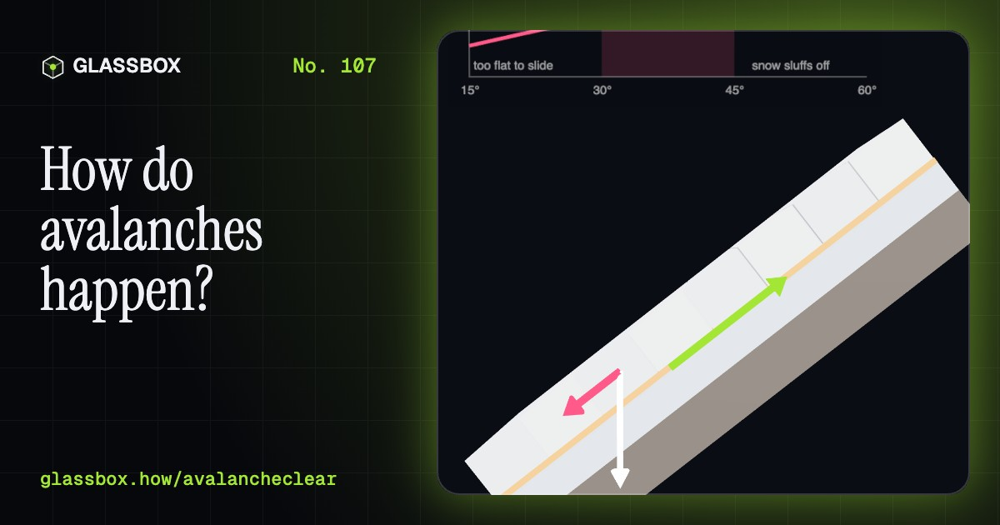
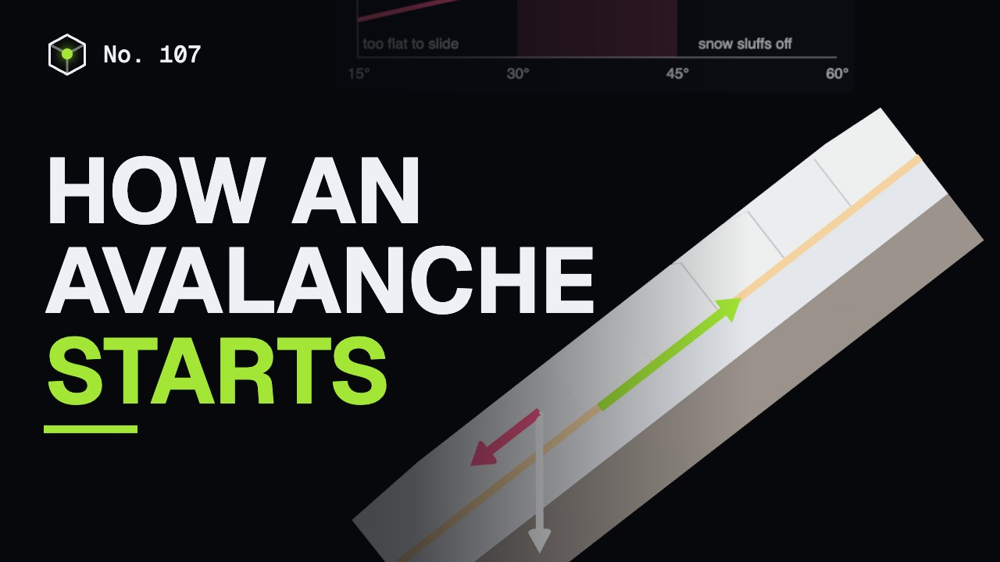
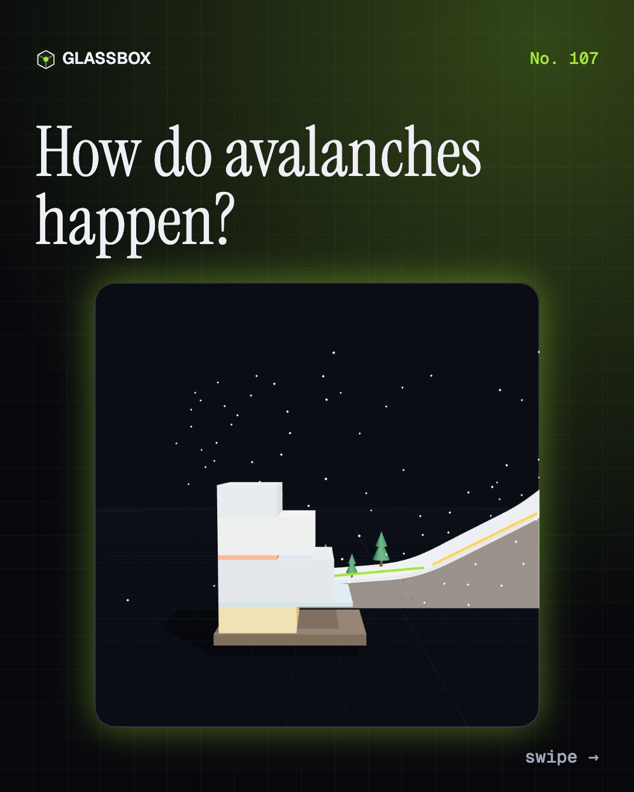
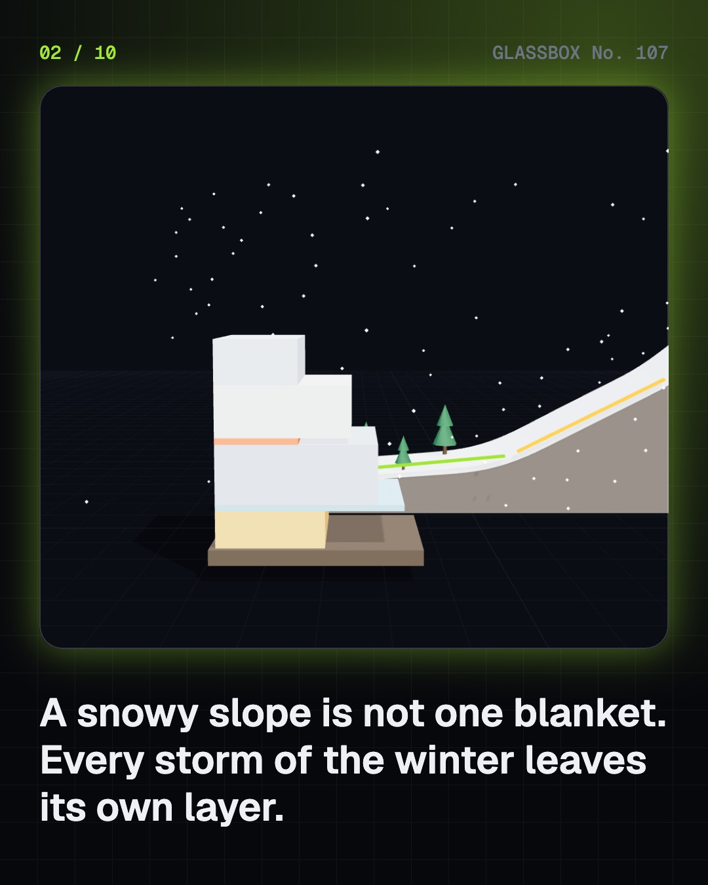
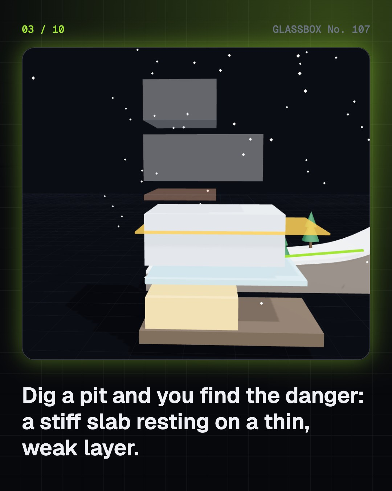
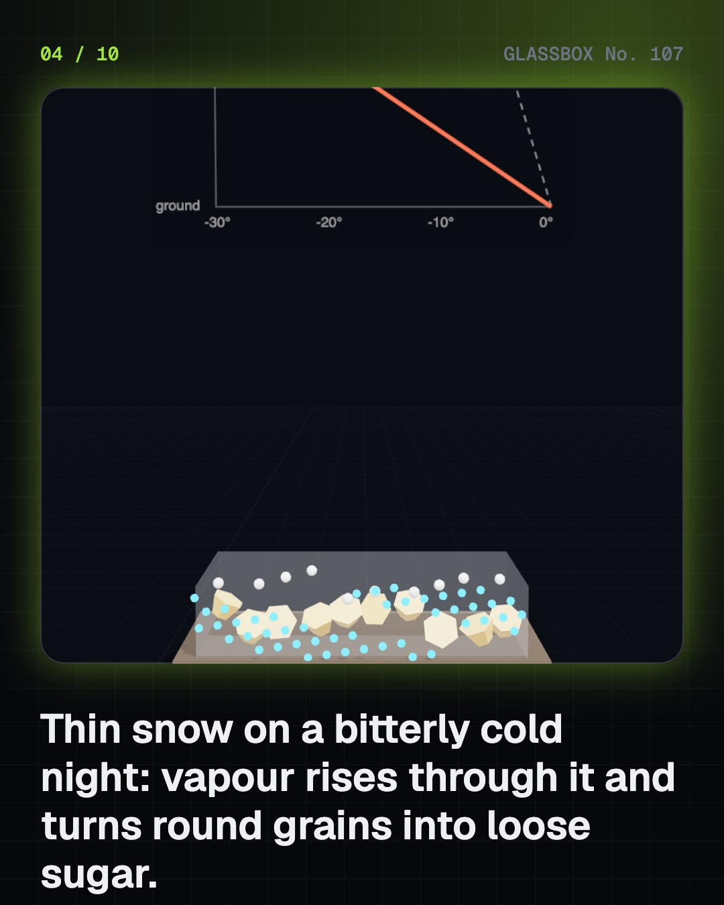

<!-- glassbox:start -->
<!-- Generated from glassbox.json by the Glassbox hub (npm run readme -- avalancheclear). Edit glassbox.json, not this block. -->
<p align="center"><a href="https://glassbox.how/e/avalancheclear/"></a></p>

<h1 align="center">AvalancheClear</h1>

<p align="center"><b>How do avalanches happen?</b><br>A snowy slope is a stack of layers, and one weak layer can let the whole slope go. Dig a snow pit, turn round grains into sugar with a cold night, load a slab until a crack races across it, release an avalanche at over 100 km/h, and learn why the first fifteen minutes decide a rescue.</p>

<p align="center"><a href="https://glassbox.how/avalancheclear/"><b>▶ Play with it</b></a> &nbsp;·&nbsp; <a href="https://glassbox.how/e/avalancheclear/">Read the 60-second explainer</a> &nbsp;·&nbsp; <a href="https://glassbox.how/avalancheclear/glassbox/reel.mp4">Watch the 40-second video</a></p>

<p align="center">
  <a href="https://glassbox.how/e/avalancheclear/"></a>
  <a href="https://glassbox.how/e/avalancheclear/"></a>
  <a href="LICENSE"></a>
  <a href="LICENSE-CONTENT.md"></a>
  <a href="#privacy"></a>
</p>

## In 60 seconds

1. **A mountain of layers.** A snowpack is a stack of layers, one from every storm, each changed by wind, sun and cold. Some are strong and some are weak. The dangerous arrangement is a stiff slab resting on a weak layer, on a start zone of 30 to 45 degrees, above a track and a runout zone where the snow ends up.
2. **The weak layer.** The ground under snow stays near 0 °C and the surface follows the air. When the temperature changes by more than about 10 °C per metre of snow, vapour rebuilds round grains into angular facets and sugary depth hoar that barely bond. Frost feathers (surface hoar) and icy crusts become weak layers once new snow buries them.
3. **The slab lets go.** The slab's weight pulls along the slope with a stress of mass × gravity × sine of the angle. The weak layer resists with its strength. When strength divided by stress falls below 1, a crack runs through the weak layer at tens of metres a second and the slab breaks away. Under about 30° it cannot slide; over about 45° snow sluffs off before a slab builds.
4. **Triggers.** A trigger adds load or removes strength: heavy snowfall, wind piling snow on the lee side of a ridge, rapid warming or rain, a cornice fall, a person, or an explosive fired on purpose. In over 90% of the slab avalanches that bury winter-sports people, the victim or someone in the group set it off (SLF, Switzerland).
5. **In motion.** Loose-snow avalanches fan out from a point, slabs break as a plate, wet avalanches are slow and dense. A dry slab can pass 100 km/h in seconds and large powder avalanches go far faster. Impact grows with the square of the speed. About nine in ten buried people survive if dug out within 10 to 15 minutes, and about three in ten by 35 minutes.
6. **The Himalaya, and staying safe.** India's avalanche country is the high Himalaya and Karakoram, from Siachen and Gurez to Lahaul, Uttarakhand and Sikkim. DGRE (formerly SASE) issues a daily Avalanche Warning Bulletin on five danger levels. Read it, stay off steep slopes after heavy snow, wind or thaw, cross one at a time, never go alone, and if someone is buried, search and dig at once. Emergency 112, NDMA 1078.

## Words worth knowing

| Term | Meaning |
|---|---|
| **Snowpack** | All the snow on the ground, built up in layers through the winter. |
| **Slab** | A stiff, cohesive layer of snow that can break away in one piece. |
| **Weak layer** | A layer of poorly bonded grains, such as depth hoar, facets or buried surface hoar, that a slab can shear off along. |
| **Temperature gradient** | How fast temperature changes through the snow. Above about 10 °C per metre, grains turn into weak facets. |
| **Stability index** | The weak layer's shear strength divided by the pull of the slab along the slope. Below 1, the slab releases. |
| **Start zone, track, runout** | Where an avalanche breaks away (usually 30 to 45°), the path it follows, and the gentler ground where it stops. |
| **Lee slope** | The sheltered side of a ridge, where wind drops the snow it carries and builds wind slabs and cornices. |
| **Powder cloud** | Fine snow thrown into the air by a fast dry avalanche, travelling ahead of the dense flow. |
| **Companion rescue** | Search and digging by the people on the spot with transceiver, probe and shovel: the rescue that arrives in time. |

## A short history

**From armies lost in Alpine snow to a daily bulletin for the Himalaya: how people learned why snow slides, and how to live below it.**

- **218 BCE** · Hannibal's army meets the Alpine snow (Hannibal and the Carthaginian army, The western Alps)
- **1881** · The first book on avalanches (Johann Coaz, Bern)
- **1916** · White Friday on the Alpine front (Austro-Hungarian and Italian soldiers, The Dolomites)
- **1936** · A snow laboratory on the Weissfluhjoch (The Swiss Avalanche Research Commission; Robert Haefeli and colleagues, Davos)
- **1951** · The Winter of Terror (The people of the Austrian and Swiss Alps, The Alps)
- **1968** · A radio beacon for buried people (John Lawton, Cornell Aeronautical Laboratory, Buffalo, New York)
- **1969** · India founds its snow and avalanche laboratory (Snow and Avalanche Study Establishment (SASE), DRDO, Manali, Himachal Pradesh)
- **1994** · The survival curve (Markus Falk, Hermann Brugger and Liselotte Adler-Kastner, Innsbruck and Bolzano)

The full story, with 29 moments, charts, people and 34 sources: [glassbox.how/e/avalancheclear/history](https://glassbox.how/e/avalancheclear/history/). The data lives in [`history.json`](history.json).

## Video and slides

Made with the Glassbox studio from this box's storyboard (`window.glassbox.director`). Free to reuse under CC BY 4.0.

<a href="https://glassbox.how/avalancheclear/glassbox/video.mp4"></a>

<p><a href="glassbox/slide-1.jpg"></a> <a href="glassbox/slide-2.jpg"></a> <a href="glassbox/slide-3.jpg"></a> <a href="glassbox/slide-4.jpg"></a></p>

| File | What | Size |
|---|---|---|
| [`glassbox/reel.mp4`](https://glassbox.how/avalancheclear/glassbox/reel.mp4) | Reel / Short, with captions and soundtrack | 1080×1920 |
| [`glassbox/video.mp4`](https://glassbox.how/avalancheclear/glassbox/video.mp4) | YouTube video, with captions and soundtrack | 1920×1080 |
| `glassbox/slide-1…10.jpg` | Instagram carousel | 1080×1350 |
| `glassbox/thumb.jpg` | YouTube thumbnail | 1280×720 |
| `glassbox/cover.jpg` | Share card and repo social preview | 1200×630 |
| [`glassbox/history-reel.mp4`](https://glassbox.how/avalancheclear/glassbox/history-reel.mp4) | “History in 10 moments” Reel / Short | 1080×1920 |
| `glassbox/history-slide-*.jpg` | History carousel | 1080×1350 |
| `glassbox/post.json` | Post copy and schedule used by the publish kit | |

## Privacy

This box has no accounts and no ads, and it ships its own fonts and libraries. When you run it yourself it sends nothing anywhere. On glassbox.how, the site's `/bar.js` also loads Glassbox's analytics: **Google Analytics** to count visits (it asks first in the EU, UK and Switzerland, and stays off when your browser sends Global Privacy Control or Do Not Track) and **ClickTrust** to detect bots.

It remembers a few things **in your own browser only**, and never sends them anywhere:

| Browser storage key | What it holds |
|---|---|
| `avalancheclear.v1` | Which chapters you have opened, your best quiz scores, and sound on or off. |

Exactly what each one sees is at [glassbox.how/privacy](https://glassbox.how/privacy/).

## Licences

- **Code:** [MIT](LICENSE). Use it, change it, ship it.
- **Explanations, text, images and videos** (`glassbox.json`, `glassbox/`): [CC BY 4.0](LICENSE-CONTENT.md). Credit “Glassbox, glassbox.how/e/avalancheclear”.
- **Third-party parts** keep their own licences: [three.js](https://threejs.org) (MIT), [Geist, Instrument Serif](https://openfontlicense.org) (SIL OFL 1.1).
- The Glassbox name and logo aren't covered by either licence. See the [terms](https://glassbox.how/terms/).

Found a mistake? [Open an issue](https://github.com/bdeeps/avalancheclear/issues). Corrections happen in public.
<!-- glassbox:end -->

## Run it

It's plain HTML, CSS and JavaScript. No build step and no dependencies. Run locally, it contacts no other website.

```bash
python3 -m http.server 8000
```

Three.js and the fonts ship in `vendor/` and `fonts/`, so it also works offline.

Then open http://localhost:8000.

## How it's built

| File | What |
|---|---|
| `index.html`, `css/app.css` | The page and its styles |
| `js/app.js`, `js/stage.js`, `js/ui.js`, `js/kit.js` | The shared Glassbox 3D engine: chapters, 3D stage, controls, quiz, video director |
| `js/snow.js` | AvalancheClear's shared physics and parts: slab stability, the temperature-gradient rule, Voellmy's avalanche model, the survival curve, the mountain profile and chart boards |
| `js/chapters/*.js` | One file per chapter: the 3D model, controls, text, key terms, quiz and video scenes |
| `glassbox.json` | Title, question, explainer beats, key terms, browser storage and credits shown on glassbox.how |
| `reel` in each chapter | The storyboard the Glassbox studio records into short videos |
| `glassbox/` | The published video, slides, thumbnail and post copy |
| `fonts/`, `vendor/three/` | Self-hosted Geist and Instrument Serif (SIL OFL 1.1) and three.js (MIT) |
